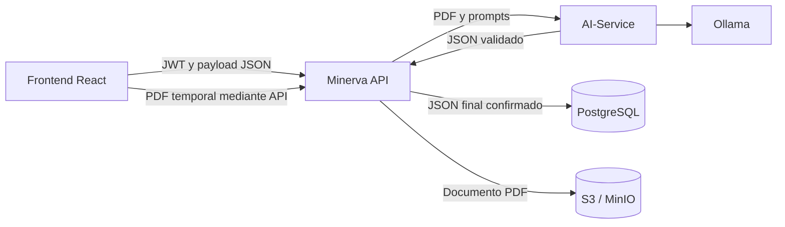
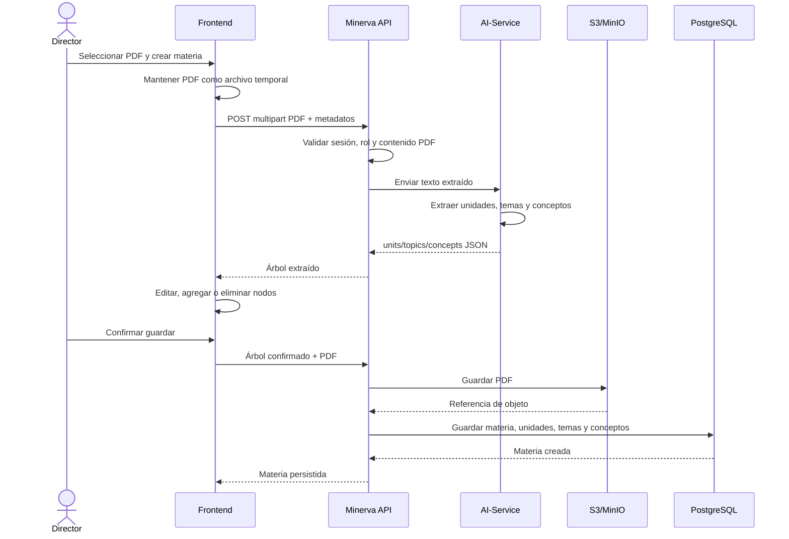
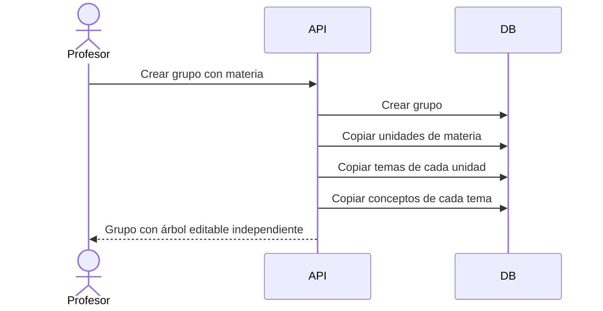
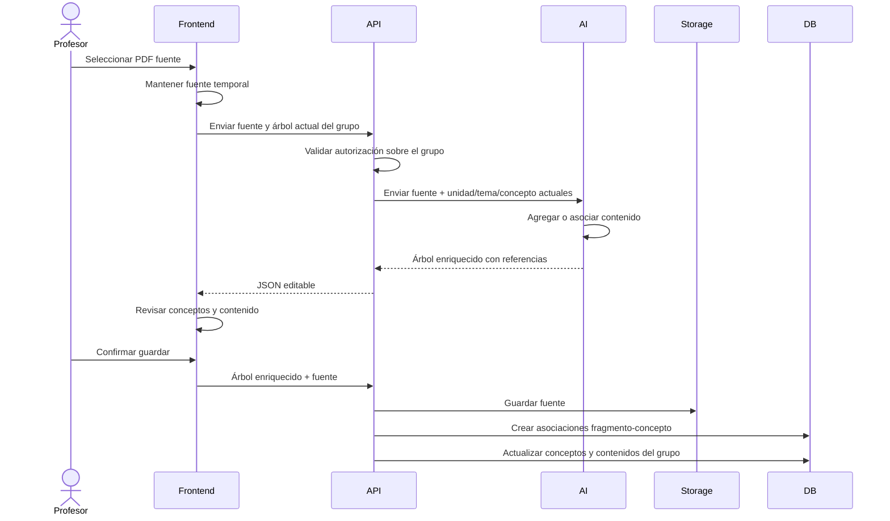
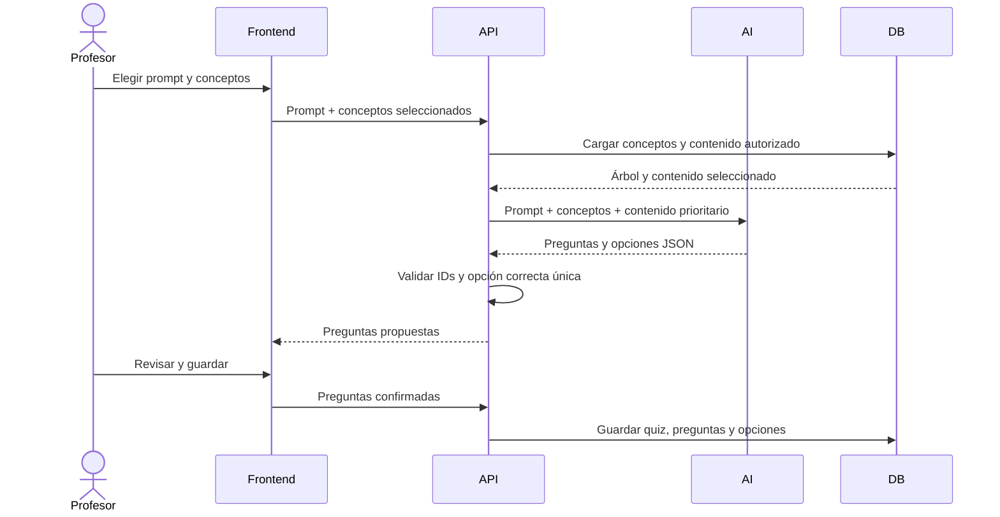
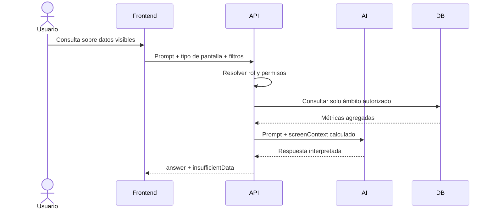
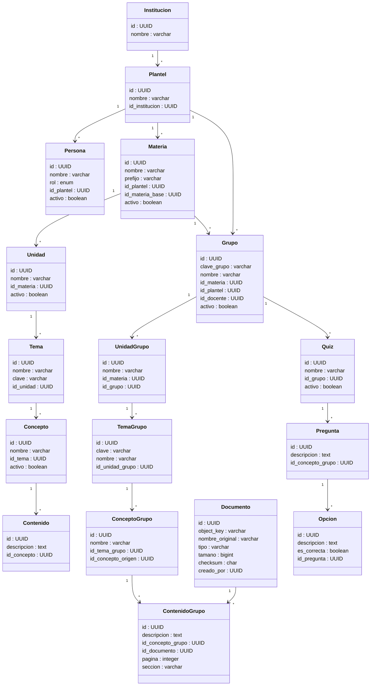
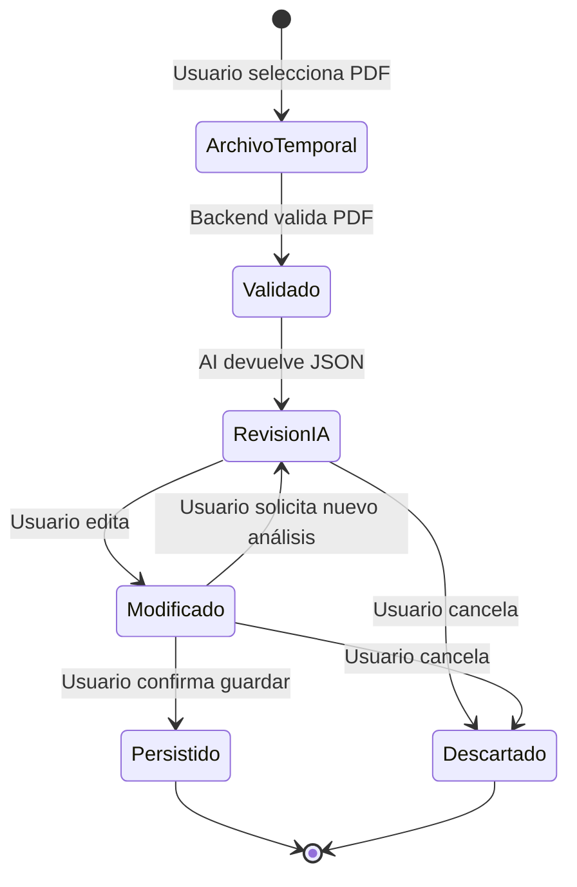

# Minerva AI-Service

Servicio Spring Boot privado para desglosar documentos PDF, generar preguntas de quiz e interpretar contexto estadístico preparado por Minerva. Ollama y el modelo se ejecutan en el host; el servicio no accede a PostgreSQL ni a S3/MinIO.

## Requisitos

- Java 25.
- Maven 3.9 o posterior.
- Ollama instalado y ejecutándose con `qwen3:4b` disponible.
- Minerva API autentica al usuario y autoriza el ámbito antes de llamar a este servicio.

## Configuración local en Windows

Desde PowerShell en la raíz del proyecto:

```powershell
Copy-Item .env.example .env
```

Genera un secreto de al menos 32 caracteres y colócalo en `AI_SERVICE_API_KEY` dentro de `.env`. Minerva API deberá enviar el mismo valor en el header `X-AI-Service-Key`. No compartas ni subas el `.env`.

Configuración predeterminada: Ollama en `http://127.0.0.1:11434`, modelo `qwen3:4b`, AI-Service en el puerto `8000`. La Minerva API en Docker Desktop puede acceder al AI-Service del host mediante `http://host.docker.internal:8000`.

Inicia el servicio:

```powershell
mvn spring-boot:run
```

El servidor escucha en las interfaces del host para aceptar la conexión desde Docker. Mantén el puerto 8000 bloqueado a redes no confiables en Windows Firewall. No abras puertos del router ni publiques este servicio u Ollama mediante Tailscale Funnel.

## API

### Estado del modelo

`GET /health` consulta Ollama y confirma que el modelo configurado esté instalado. Devuelve `200` si está disponible y `503` si Ollama no responde o falta el modelo. El endpoint no requiere la clave interna; restríngele el acceso mediante la red/firewall.

### Desglosar PDF

`POST /documents/extract`

Requiere `X-AI-Service-Key` y `multipart/form-data` con campo `file`. Acepta PDF de hasta 10 MiB, extrae texto seleccionable sin OCR y devuelve `units → topics → concepts`.

### Generar quiz

`POST /quizzes/generate`

Requiere `X-AI-Service-Key`. Recibe un JSON con `prompt` y `concepts`; devuelve preguntas con opciones y exactamente una opción correcta por pregunta.

### Interpretar estadísticas

`POST /statistics/interpret`

Requiere `X-AI-Service-Key`. Recibe `prompt` y `screenContext` ya autorizado y agregado por Minerva. El modelo interpreta únicamente ese contexto; no accede a datos ni inventa métricas.

La clave de servicio es solo para comunicación backend-a-backend. Los usuarios finales no reciben esta clave. Minerva mantiene la autenticación y autorización por materia, grupo, plantel e institución.

### Generar cambios temporales de currículo

`POST /curriculum/generate`

Requiere `X-AI-Service-Key` y `multipart/form-data` con:

- `request`: JSON `application/json` con el grupo, el árbol temporal completo y las fuentes.
- `files`: uno o más PDF asociados a las fuentes nuevas.

Ejemplo de `request`:

```json
{
  "grupoId": "GRP-1",
  "materiaNombre": "Ingenieria de Software",
  "arbol": {
    "tipo": "materia",
    "nombre": "Ingenieria de Software",
    "origen": "materia",
    "revisionEstado": "original",
    "hijos": []
  },
  "fuentes": [
    {
      "documentoId": "DOC-101",
      "checksumSha256": "abc123",
      "nombre": "guia-scrum.pdf"
    }
  ],
  "fuentesProcesadas": [],
  "modoFusion": "conservadora"
}
```

La operación no persiste cambios. Devuelve `persistido: false` y un árbol temporal completo.

Los nodos y contenidos agregados por IA incluyen:

```json
{
  "origen": "ia",
  "revisionEstado": "pendiente_revision"
}
```

La IA conserva los nodos originales y solo agrega o alimenta contenido. No elimina, desactiva ni reemplaza nodos existentes.

Solo se procesan fuentes que no aparezcan en `fuentesProcesadas`. Si una fuente ya fue procesada, debe volver a subirse para formar parte de una nueva ejecución.

## Laboratorio de extraccion (DEV)

El frontend accede mediante Minerva API; no publiques estos endpoints directamente.
Ambos requieren `X-AI-Service-Key`:

- `GET /laboratory/documents/prompts`: devuelve `prompts` (`role`, `instructions`,
  `outputContract`), `model` y `maxPdfBytes`. Los valores iniciales viven en
  `DocumentLaboratoryService`; editar las cajas no los modifica.
- `POST /laboratory/documents/extract`: multipart con `file` (PDF) y `request`
  (parte `application/json`):

```json
{
  "sourceType": "STUDY_PLAN",
  "prompts": {
    "role": "Rol y reglas",
    "instructions": "Instrucciones de extraccion",
    "outputContract": "Estructura JSON y ejemplo"
  }
}
```

`sourceType` admite `STUDY_PLAN` (conservar estructura explicita) o
`SOURCE_MATERIAL` (organizar contenido sin conocimientos externos).
Cada capa es obligatoria y admite hasta 12000 caracteres. Se envia una sola
peticion a Ollama con las tres capas y el texto del PDF separado como fuente.

El laboratorio utiliza JSON Schema en `format`, no solo `format: "json"`.
El contrato fijo es `units[] -> name/topics[] -> name/concepts[] -> name`.
Los nombres deben ser no vacios, no se permiten campos adicionales y cada
unidad/tema debe tener hijos. `{"units":[]}` representa ausencia de contenido
didactico identificable. Editar la tercera capa no cambia este contrato.

La respuesta contiene `model`, `durationMs`, `rawOutput`, `tree` y
`validationErrors`. Una salida valida devuelve HTTP 200; una salida malformada
o incompatible devuelve HTTP 422 con `tree: null` y el diagnostico original.
No se recorta ni repara la salida, ni se reintenta automaticamente. Validez
estructural no implica fidelidad al documento.

Se reutilizan los limites de PDF (10 MiB por defecto) y texto extraido
(30000 caracteres por defecto). No hay OCR. No se guardan documentos, prompts
editados ni arboles en disco, PostgreSQL o MinIO. Los endpoints normales de
extraccion, quiz y estadisticas conservan su comportamiento.

El modelo depende del entorno de AI-Service: por ejemplo,
`OLLAMA_MODEL=qwen3:8b` en el servidor y `qwen3:4b` en desarrollo.


# Flujo didáctico de Minerva

Este documento valida la arquitectura propuesta para creación de materias,
enriquecimiento de grupos con fuentes, generación de quizzes e interpretación
estadística.

## Resumen ejecutivo

El diseño propuesto es consistente si se distingue entre **plantilla curricular**
y **árbol activo de grupo**:

```text
Materia
└── Unidad
    └── Tema
        └── Concepto
            └── Contenido base

Grupo
└── Copia de Unidad, Tema y Concepto
    └── Contenido agregado por fuentes
        └── Fuente
```

- Unidad y tema son inmutables dentro del flujo de edición de una materia.
- Concepto puede ser creado, renombrado o eliminado durante la revisión
  asistida por IA.
- El contenido pertenece al concepto y solo existe en el árbol del grupo.
- El documento fuente se conserva en S3/MinIO y su contenido se representa
  mediante fragmentos asociados a conceptos.
- Una modificación realizada sobre un grupo no altera la materia original.
- Toda operación pendiente de guardar vive temporalmente en el frontend.
- El backend valida permisos, propiedad, integridad del JSON y consistencia
  académica antes de persistir.

## Arquitectura



El frontend no llama directamente a AI-Service ni recibe su clave interna.

## 1. Creación de materia

### Flujo



### Contrato del árbol inicial

```json
{
  "units": [
    {
      "name": "Unidad 1",
      "topics": [
        {
          "name": "Tema 1",
          "concepts": [
            {
              "name": "Concepto 1"
            }
          ]
        }
      ]
    }
  ]
}
```

### Reglas

1. El PDF permanece en memoria o estado temporal del navegador hasta guardar.
2. La API debe:
   - validar tamaño máximo;
   - validar extensión `.pdf`;
   - validar firma `%PDF-`;
   - verificar autenticación y autoridad;
   - impedir nombres o rutas no válidos;
   - asociar el documento a la materia o fuente creada.
3. AI-Service solo extrae unidad, tema y concepto.
4. Unidad y tema deben considerarse inmutables después de una extracción
   confirmada por el usuario.
5. El frontend permite modificar el JSON sin persistirlo.
6. Guardar debe ser una operación transaccional:
   - si falla PostgreSQL, no debe quedar huérfana la referencia de S3;
   - si falla S3, no debe confirmarse la materia.
7. El árbol inicial puede usar IDs temporales hasta recibir IDs persistidos.

## 2. Inicialización de un grupo

Cuando se crea un grupo con una materia, el sistema debe realizar una copia
académica aislada, no compartir nodos mutables con la materia original.



El contenido de la materia base puede copiarse como contenido inicial del
grupo, si existe, o quedar vacío.

### Persistencia recomendada

```text
materia
unidad
tema
concepto

grupo
unidad_grupo
tema_grupo
concepto_grupo
contenido_grupo
grupo_documento
```

`unidad_grupo` y `tema_grupo` mantienen el desglose editable del grupo.
Aunque sean inmutables durante la creación inicial, pueden conservar `origen`.

## 3. Agregar una fuente a un grupo

La fuente es otro PDF que enriquece el árbol del grupo.



### Contrato recomendado

```json
{
  "units": [
    {
      "id": "temp-unit-1",
      "name": "Unidad 1",
      "topics": [
        {
          "id": "temp-topic-1",
          "name": "Tema 1",
          "concepts": [
            {
              "id": "concept-uuid",
              "name": "Herencia",
              "contents": [
                {
                  "id": "temp-content-1",
                  "text": "Permite reutilizar atributos y métodos.",
                  "source": {
                    "page": 42,
                    "section": "Capítulo 4",
                    "reference": "fragmento-uuid"
                  }
                }
              ]
            }
          ]
        }
      ]
    }
  ]
}
```

### Reglas

- AI-Service recibe el árbol actual, no la base de datos.
- Unidad y tema se conservan como nombres y posiciones existentes.
- AI puede editar conceptos y contenido.
- AI puede agregar conceptos siempre que exista dentro de un tema recibido.
- No se debe permitir que AI modifique IDs persistidos.
- Cada fragmento debe conservar procedencia:
  documento, página, sección y texto.
- La revisión del usuario reemplaza el estado temporal completo.
- No se agrega el árbol al grupo hasta confirmar guardar.
- El documento se registra una sola vez por fuente.

## 4. Generación de quiz



### Prioridad de contexto

1. Contenido asociado al concepto seleccionado.
2. Definición y fragmentos del mismo concepto.
3. Conceptos relacionados del tema o unidad.
4. Si no existe contenido, el concepto puede pasar al modelo.

En el último caso, el prompt debe indicar que la pregunta puede requerir
revisión y el profesor debe decidir si se conserva.

### Contrato actual compatible

```json
{
  "prompt": "Instrucción de generación",
  "concepts": [
    {
      "id": "concepto-uuid",
      "name": "Herencia",
      "contents": [
        "Permite reutilizar atributos y métodos."
      ]
    }
  ]
}
```

Respuesta:

```json
{
  "questions": [
    {
      "conceptId": "concepto-uuid",
      "question": "¿Qué permite la herencia?",
      "options": [
        {
          "text": "Reutilizar atributos y métodos.",
          "isCorrect": true
        },
        {
          "text": "Eliminar todos los objetos.",
          "isCorrect": false
        }
      ]
    }
  ]
}
```

### Validaciones obligatorias

- Cada pregunta debe pertenecer a un concepto seleccionado.
- Cada pregunta debe tener exactamente una opción `isCorrect: true`.
- Debe existir al menos una opción incorrecta.
- Los IDs devueltos deben existir en el árbol cargado.
- La API debe persistir solo después de la confirmación del profesor.
- El rol debe tener acceso al grupo.
- La configuración de cantidad, dificultad y idioma debe validarse.

La implementación actual ya valida la opción correcta única y el concepto
seleccionado en `QuizGenerationService`.

## 5. Material estadístico

El backend calcula las métricas y prepara un contexto seguro.



El backend no debe entregar al modelo:

- datos personales innecesarios;
- contraseñas o tokens;
- datos de planteles fuera del ámbito;
- resultados de usuarios no visibles;
- métricas de institución si el usuario no tiene permiso.

### Matriz de permisos

| Rol | Grupo propio | Quiz | Plantel | Institución |
|---|---:|---:|---:|---:|
| Alumno | Solo grupos asignados | Solo sus intentos | No | No |
| Docente | Solo grupos asignados | Solo sus quizzes | No | No |
| Coordinador | Grupos de su plantel | Grupos de su plantel | Solo su plantel | No |
| Director de plantel | Todos los grupos de sede | Todos los quizzes de sede | Solo su plantel | No |
| Director general | Todos | Todos | Todos | Todos |
| DEV | Definido por ambiente y auditoría | Según autorización | Según autorización | Según autorización |

Si el usuario solicita otra sección, la respuesta debe indicar que no tiene
alcance y sugerir navegar a una pantalla autorizada.

La implementación actual permite enviar `prompt` y `screenContext`.
La autorización real debe resolverse antes de construir `screenContext`.

## Modelo UML de persistencia



## Estados temporales y persistidos

Los resultados intermedios de IA no se deben representar como entidades
persistidas hasta guardar:



## Endpoints existentes

| Operación | Endpoint | Estado actual |
|---|---|---|
| Extracción laboratorio | `POST /api/ai/laboratory/documents/extract` | Implementado |
| Prompts extracción | `GET /api/ai/laboratory/documents/prompts` | Implementado |
| Health AI | `GET /api/ai/health` | Implementado |
| Generación quiz | `POST /quizzes/generate` en AI-Service | Implementado en AI |
| Interpretación estadísticas | `POST /statistics/interpret` en AI-Service | Implementado en AI |
| Guardar PDF | API de almacenamiento | Implementado |

## Brechas pendientes

1. Crear endpoints backend públicos para flujos normales de:
   - materia;
   - enriquecimiento de fuente;
   - generación de quiz;
   - interpretación estadística.
2. Guardar unidades, temas, conceptos y contenidos de grupo.
3. Crear copia independiente de materia al crear grupo.
4. Asociar documentos con materia, grupo y fragmentos.
5. Añadir DTO de `contenido` al contrato de quiz.
6. Calcular `screenContext` en el backend según rol y filtros.
7. Validar autorización por materia, grupo, plantel e institución.
8. Crear migraciones para las entidades `unidad_grupo`,
   `tema_grupo`, `concepto_grupo`, `contenido_grupo` y
   `grupo_documento`.
9. Persistir fuente solo después de confirmar el árbol enriquecido.
10. Añadir auditoría de extracción, modificación y confirmación.

## Validación final

Los cuatro flujos son compatibles con la arquitectura actual si se cumplen
las reglas anteriores. El principal ajuste es convertir el enriquecimiento de
fuentes en una copia persistible por grupo y evitar que el agente consulte
directamente PostgreSQL o almacenamiento.

